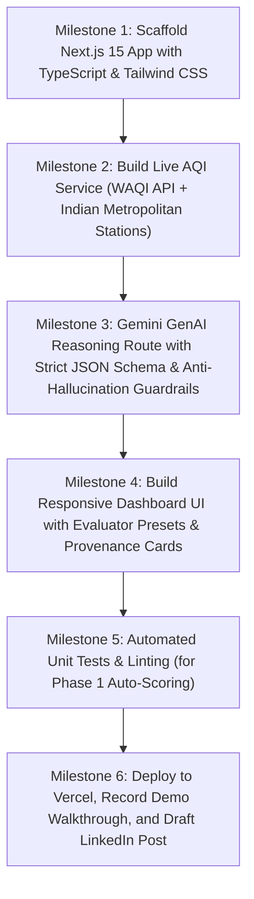

# PromptWars Virtual Challenge 6: Urban Air Quality Assistant
## Master Project Brief & Execution Blueprint

---

### 1. Executive Summary & Challenge Goals
- **Challenge:** PromptWars Virtual Challenge 6 ("Urban Air Quality Assistant") hosted by Hack2skill.
- **Theme:** An intelligent, context-aware GenAI web application built to help Indian citizens (Delhi NCR, Mumbai, Kolkata, Bengaluru, etc.) navigate severe winter smog and post-Diwali air pollution.
- **Key Objective:** Go beyond a passive, static AQI dashboard. Create an active operational assistant that combines **live, real-time air quality metrics** with **demographic personas** to provide concrete health, commute, and indoor recommendations.
- **Participation:** Individual participation, India-based.

---

### 2. The 3 Mandatory Functional Pillars

Every recommendation generated by the assistant must map to one of these three core areas:

1. **Low-Emission Daily Routines & Commute Optimization**
   - Public transit / metro shifts, EV prioritization, carpooling, combining trips.
   - Outdoor activity timing based on diurnal atmospheric stagnation (avoiding early morning/late evening temperature inversions).

2. **Indoor Air Quality Interventions & Management**
   - Intelligent air purifier operating schedules (timed cycles vs continuous).
   - Window ventilation windows: identifying brief mid-day windows when smog lifts vs full sealing.
   - Botanical filtering (Snake Plants, Areca Palms) and wet-mopping to suppress resuspended fine dust.

3. **Sustainable Alternatives with Explicit "Why & Impact" Justifications**
   - The assistant **must explicitly explain WHY** an action is recommended.
   - Provide dual impact articulation:
     - **Personal Health Impact:** (e.g., "Reduces PM2.5 alveolar penetration by ~70% during peak commute").
     - **Collective Ecological Impact:** (e.g., "Consolidating errands cuts ~1.8 kg CO2 and prevents cold-start emissions").

---

### 3. Persona-Driven Personalization & Evaluator Presets

Recommendations **must never be one-size-fits-all**. An AQI of 380 in Delhi requires completely different actions for different people.

#### Mandatory Pre-Configured Presets (for Instant Evaluator Testing):
1. **Daily Office Commuter:**
   - 28-year-old traveling 18 km each way by bike or metro.
   - Needs: Commute departure timing, metro vs road routes, cabin recirculation, N95 mask guidance.
2. **Parent of a Toddler:**
   - Mother/father with a 3-year-old child in an apartment.
   - Needs: Playground safety thresholds, nursery purification, ventilation hours, pediatric vulnerability warnings.
3. **Senior Citizen with Asthma:**
   - 68-year-old retiree with mild respiratory vulnerability.
   - Needs: Shifting morning walks to indoor walking, oxygenation routines, strict particulate avoidance.
4. **Student / School Athlete:**
   - 15-year-old with mandatory 4:00 PM outdoor sports practice.
   - Needs: Relocating high-cardiovascular sports indoors, travel masking, hydration protocols.
5. **Custom Persona Input:**
   - Form fields allowing any user to input their custom age, health conditions, and daily routine.

---

### 4. Golden Rules & Architectural Guardrails

| Constraint | Requirement & Rationale |
| :--- | :--- |
| **Strict Data Boundary** | **Real-Time API Only** (WAQI / OpenAQ / CPCB). **NEVER let GenAI guess or fabricate AQI numbers**. |
| **Data Provenance** | The UI **must visibly display** the live monitoring station name, data source (CPCB/WAQI), and the exact update timestamp. |
| **Structured Output** | GenAI responses must be strictly typed JSON (matching the 3 pillars) to prevent broken formatting. |
| **Two-Phase Evaluation** | Phase 1: Automated code check (Code quality, security, accessibility, tests).<br>Phase 2: Human prototype verification on the live app. |
| **Final Attempt Rule** | Maximum 3 submissions, but **only the score of the final attempt counts**. |

---

### 5. Mandatory Deliverables for Submission

1. **Publicly Deployed Application Link:** Working web URL (e.g., on Vercel or Cloud Run).
2. **Public GitHub Repository:** Clean code, TypeScript, unit tests, and comprehensive README.
3. **Screen Recording Demo Video:** Demonstrating live data fetching, persona switching, and dynamic AI guidance (protects against API rate limits during manual evaluation).
4. **LinkedIn Technical Architecture Post:** Explaining the system architecture, prompt evolution, and distinguishing what GenAI generated vs what was manually engineered.

---

### 6. Recommended Technical Stack

- **Framework:** Next.js 15 (App Router, TypeScript)
- **Styling & UI:** Tailwind CSS, Lucide React icons, accessible design primitives
- **Live Data Source:** World Air Quality Index (WAQI / AQICN API) aggregating CPCB India stations
- **Generative AI:** Google Gemini API (`@google/genai` or `@google/generative-ai` with `gemini-1.5-flash` or `gemini-2.0-flash`)
- **Testing:** Jest / Vitest + React Testing Library (for automated code evaluation points)

---

### 7. Step-by-Step Implementation Roadmap



---

### 8. Prompt Template Specification (Gemini)

```text
System Instructions:
You are the Urban Air Quality Assistant, an expert environmental and health intelligence AI.
You receive:
1. Live verified AQI metrics (AQI, PM2.5, PM10, Station, Timestamp).
2. User demographic persona, health context, and daily schedule.

STRICT CONSTRAINTS:
- NEVER invent, modify, or predict numerical AQI or PM values. Treat the provided numbers as verified ground truth.
- Base all advice strictly on the verified numbers and the user's specific persona.
- Output MUST be valid JSON adhering strictly to the schema with the 3 pillars:
  1. lowEmissionRoutines (commuteMode, outdoorTiming, tripOptimization)
  2. indoorAirQualityHacks (purifierSchedule, ventilationWindows, botanicalProtection)
  3. sustainableAlternatives (recommendations with explicit causal why &amp; quantified health/ecological impact)
```

---

### 9. Environment Variables (`.env.local`)
```env
# Google Gemini API Key
GEMINI_API_KEY=your_gemini_api_key_here

# WAQI API Token
WAQI_API_TOKEN=your_waqi_api_token_here
```
