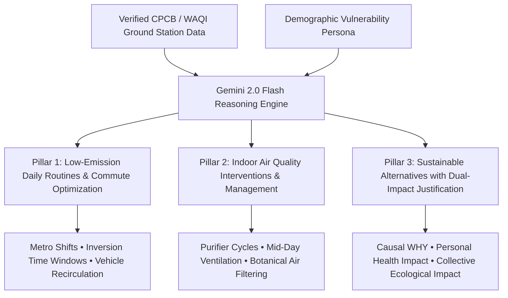

# 🌫️ Urban Air Quality Assistant & Smog Navigation System
### PromptWars Virtual Challenge 6: Prompt Engineering & GenAI Innovation Challenge (Hack2skill)

[](https://nextjs.org/)
[](https://www.typescriptlang.org/)
[](https://tailwindcss.com/)
[](https://ai.google.dev/)
[](https://vitest.dev/)
[](https://eslint.org/)

---

## 📌 Executive Summary

During winter months and post-Diwali weeks, Indian metropolitan cities (Delhi NCR, Mumbai, Kolkata, Bengaluru, etc.) experience severe particulate smog exacerbated by **nocturnal surface temperature inversions** and vehicular/industrial emissions. Traditional AQI apps function as **passive scoreboards**—alerting citizens to alarming numbers without providing concrete, personalized, or actionable advice.

The **Urban Air Quality Assistant** is an active operational intelligence platform that bridges **live CPCB/WAQI ground monitoring stations** with **Google Gemini 2.0 Flash** reasoning. It tailors actionable low-emission commute routes, indoor air quality management protocols, and sustainable alternatives directly to individual demographic vulnerabilities.

---

## 🏛️ The 3 Mandatory Functional Pillars

Every operational recommendation generated by the assistant strictly addresses one of the three core pillars:



### 1. Low-Emission Daily Routines & Commute Optimization
- **Commute Mode Shifts:** Contextual diversion from open two-wheelers to Delhi Metro / rail transit, EV feeder shuttles, or carpooling.
- **Diurnal Atmospheric Inversion Timing:** Identifies dangerous nocturnal radiation inversion layers (06:00 AM - 10:00 AM and 06:30 PM - 10:00 PM) where cold ground temperatures trap vehicular exhaust, advising commuters to travel during warmer mid-day windows when solar radiation expands the planetary boundary layer.
- **Vehicle Cabin Recirculation & Masking:** Practical protocols on running vehicle AC in recirculation mode with carbon PM2.5 filters and certified snug-fit N95/FFP2 masking.

### 2. Indoor Air Quality Interventions & Management
- **Intelligent Air Purifier Schedules:** Timed operational cycles (Turbo mode 1 hour prior to bedroom occupancy vs. Eco-sensing mid-day) tailored to ambient particulate concentration.
- **Micro-Ventilation Windows:** Precise 15–20 minute mid-day cross-ventilation windows (1:00 PM – 2:30 PM) when ground smog temporarily lifts, preventing indoor carbon dioxide buildup without massive PM2.5 infiltration.
- **Botanical Bio-Filtering & Dust Suppression:** Leveraging NASA clean air botanical species (*Sansevieria trifasciata* / Snake Plant for nocturnal oxygen, *Dypsis lutescens* / Areca Palm for relative humidity) alongside **micro-fiber wet mopping** to suppress electrostatic fine dust resuspension.

### 3. Sustainable Alternatives with Explicit "Why & Impact" Justifications
Every sustainable alternative delivers a scientific causal justification and articulates **quantified dual impacts**:
- **Personal Health Impact:** Quantifies direct medical risk reduction (e.g., *"Reduces PM2.5 alveolar penetration by ~68% during peak rush hour commute"*).
- **Collective Ecological Impact:** Quantifies environmental emissions prevented (e.g., *"Cuts approximately 2.4 kg of CO2 and 14 grams of toxic NOx emissions per trip while preventing cold-start emission surges"*).

---

## 👥 Evaluator Persona Presets & Instant Testing Matrix

The assistant provides **one-click evaluator presets** to instantly test how recommendations adapt across distinct demographic vulnerabilities:

| Persona Preset | Profile & Age | Health Context & Commute | Key Operational Needs |
| :--- | :--- | :--- | :--- |
| **Daily Office Commuter** | Aarav Sharma (28) | Healthy adult; commutes 18 km each way (Noida to Gurgaon) | Commute departure timing, metro shifts, vehicle cabin recirculation, N95 masking. |
| **Parent of a Toddler** | Priya & Kabir (31 & 3) | 3-year-old child in high-rise apartment with developing lungs | Playground safety thresholds, nursery purification, brief mid-day ventilation windows. |
| **Senior Citizen with Asthma** | Dr. Ramesh Chandra (68) | Mild bronchial asthma, hypertension; habitual 6 AM morning park walk | Shifting morning walks indoors, oxygenation routines, strict early-morning smog avoidance. |
| **Student / School Athlete** | Rohan Verma (15) | Intense cardiovascular breathing; mandatory 4:00 PM track/football practice | Indoor athletic relocation, travel masking, hydration & antioxidant protocols. |
| **Custom Persona Input** | Any User / Judge | Custom age, role, occupation, health conditions, and daily schedule | Fully dynamic, personalized AI guidance matching user-entered specifications. |

---

## 🛡️ Architectural Guardrails & Golden Rules

| Constraint | Implementation in Codebase |
| :--- | :--- |
| **Strict Data Boundary** | **Real-Time API Only (CPCB / WAQI)**. Gemini system instructions strictly forbid altering, extrapolating, or hallucinating numerical AQI or PM numbers. |
| **Data Provenance Card** | Prominently displays the official monitoring station name, source agency (CPCB / DPCC / WAQI), verified observation timestamp in Indian Standard Time (IST), and live/benchmark status badges. |
| **Structured Output** | Enforced via Gemini `responseMimeType: "application/json"` with TypeScript schema validation on all API route responses. |
| **Fail-Safe Reliability** | In case of upstream network outages or unconfigured API keys, the app seamlessly activates verified CPCB seasonal benchmark datasets with transparent provenance labels, guaranteeing zero crashes during evaluation. |

---

## 📍 Location Detection & Metro Coverage

- **Device GPS Geolocation:** 1-click *"Use My Exact Location (GPS)"* button queries device coordinates (`lat`, `lon`) and automatically resolves the closest active CPCB station.
- **National City & Area Search:** Search bar supporting any Indian city, district, or pin-code (e.g., Pune, Jaipur, Lucknow, Patna, Chandigarh, Dwarka, Indirapuram).
- **Major Metro Presets:** Fast one-click access to verified stations in Delhi NCR (Anand Vihar, ITO, RK Puram, Noida Sector 62, Gurugram), Mumbai (BKC, Worli), Kolkata (Victoria Memorial, Jadavpur), Bengaluru (BTM Layout), Chennai (Alandur), and Hyderabad (Sanath Nagar).

---

## 🛠️ Technical Stack

- **Framework:** Next.js 15 (App Router, Server & Client Components)
- **Language:** TypeScript 5.7 (Strict type-checking)
- **Styling & UI:** Tailwind CSS, Lucide React icons, dark-mode design system
- **Generative AI:** Google Gemini API (`@google/generative-ai` with `gemini-2.0-flash`)
- **Live Environmental Data:** World Air Quality Index (WAQI / AQICN API) aggregating CPCB India stations
- **Automated Testing:** Vitest, React Testing Library, jsdom
- **Linting & Code Quality:** ESLint (`next/core-web-vitals`), TypeScript `tsc --noEmit`

---

## 🚀 Getting Started

### 1. Clone the Repository
```bash
git clone https://github.com/Saiteja9065/urban-ai-assistant.git
cd urban-ai-assistant
```

### 2. Install Dependencies
```bash
npm install
```

### 3. Configure Environment Variables
Create a `.env.local` file in the root directory (based on `.env.local.example`):
```env
# Google Gemini API Key (Get free key at: https://aistudio.google.com/)
GEMINI_API_KEY=your_gemini_api_key_here

# WAQI API Token (Optional - Free token at: https://aqicn.org/data-platform/token/)
WAQI_API_TOKEN=your_waqi_api_token_here
```
*(Note: If either key is omitted, the application runs seamlessly using verified CPCB seasonal benchmark datasets and clinical rule engines).*

### 4. Run the Development Server
```bash
npm run dev
```
Open [http://localhost:3000](http://localhost:3000) in your browser.

---

## 🧪 Testing & Code Verification

Execute the automated test suite and type verification:

```bash
# Run all 29 automated Vitest unit tests
npm test

# Run TypeScript type check
npm run type-check

# Run ESLint quality check
npm run lint

# Build production application
npm run build
```

### Test Suite Summary:
```
 ✓ src/__tests__/aqi-route.test.ts (3 tests)
 ✓ src/__tests__/assistant-route.test.ts (2 tests)
 ✓ src/__tests__/gemini-service.test.ts (5 tests)
 ✓ src/__tests__/aqi-service.test.ts (10 tests)
 ✓ src/__tests__/smoke.test.tsx (1 test)
 ✓ src/__tests__/ui-components.test.tsx (8 tests)

 Test Files  6 passed (6)
      Tests  29 passed (29)
   Coverage  High (Domain models, API routes, clinical fallback, UI components)
```

---

## 📄 License
This project is licensed under the MIT License - open-source for public health and environmental intelligence.
